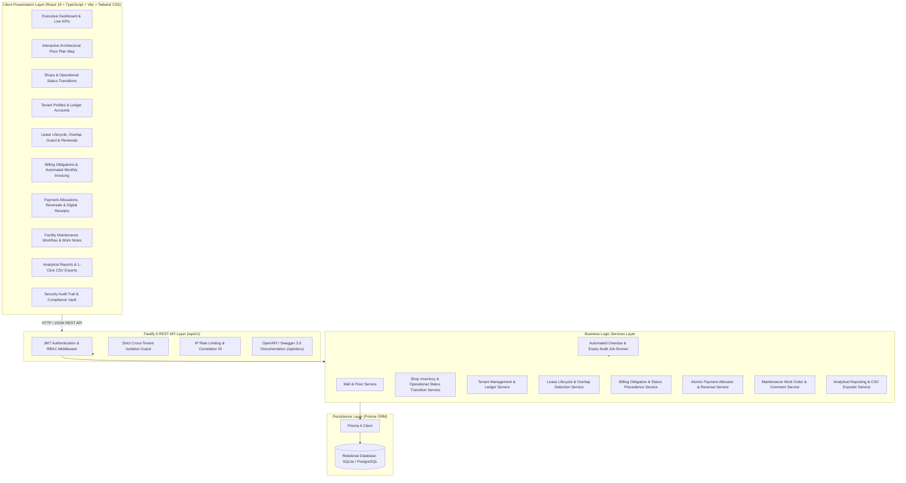
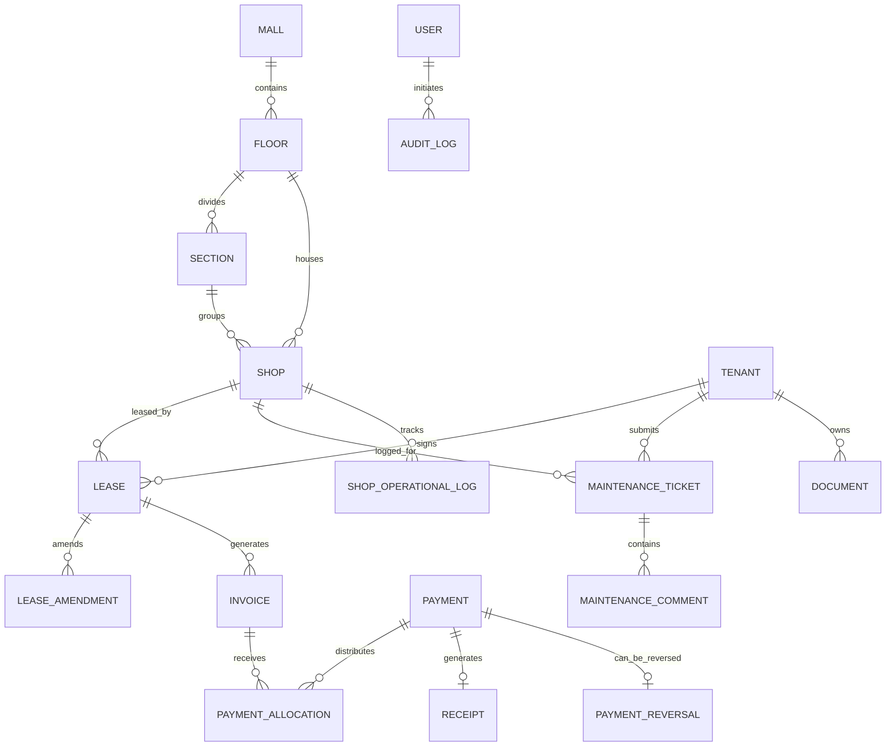

# Starlight Galleria — Production-Ready Mall Management System (MMS)

A comprehensive, enterprise-grade **Mall Management System (MMS)** engineered to govern commercial retail real estate, multiple floors and architectural sections, shop inventories, multi-year lease covenants, automated recurring rent billing, multi-obligation payment allocations, financial reversals, facility maintenance work orders, compliance document tracking, and real-time executive analytics.

---

## 1. System Architecture & Tech Stack



### Technology Matrix
- **Backend API**: [Fastify 5](https://fastify.dev/) with TypeScript (Strict mode)
- **Database & ORM**: [Prisma ORM 6](https://www.prisma.io/) with SQLite (local development / embedded engine) & PostgreSQL (Docker / production)
- **Frontend App**: [React 19](https://react.dev/), [TypeScript](https://www.typescriptlang.org/), [Vite 6](https://vitejs.dev/), [Tailwind CSS 3](https://tailwindcss.com/)
- **Visualizations**: [Recharts](https://recharts.org/) for executive financial trends and category distributions
- **Icons**: [Lucide React](https://lucide.dev/)
- **Testing**: [Vitest](https://vitest.dev/) for unit, financial calculation, and integration test suites
- **Security & RBAC**: JWT tokens with bcrypt password hashing and server-enforced role authorization

---

## 2. Entity-Relationship Model (ERD)



---

## 3. User Roles & Permission Matrix

| Role | Dashboard & Reports | Floor & Shop Management | Leases & Renewals | Record Payments & Receipts | Reversals & Refunds | Maintenance Work Orders | Audit Logs | Settings |
| :--- | :---: | :---: | :---: | :---: | :---: | :---: | :---: | :---: |
| **MALL_OWNER** | Full Portfolio | Full Control | Full Control | Full Access | Full Access | Full Control | Full Access | Full Access |
| **MALL_MANAGER** | Operational | Full Control | Create & Renew | View Only | Forbidden | Full Control | Forbidden | Forbidden |
| **ACCOUNTANT** | Financial & Aging | View Only | View Only | Record & Issue | Full Access | View Only | Forbidden | Forbidden |
| **MAINTENANCE** | Operational | View Units | Forbidden | Forbidden | Forbidden | Status & Work Notes | Forbidden | Forbidden |
| **TENANT** | Self-Service Portal | Own Leased Units | View Own | View Own Receipts | Forbidden | Submit & Track Own | Forbidden | Forbidden |

---

## 4. Demonstration Accounts (Instant 1-Click Evaluation)

The application includes preconfigured demonstration profiles for each system role. You can switch between them seamlessly using the **Role Switcher dropdown** in the top navigation bar, or log in via `/login`:

| Role | Name | Email | Default Password | Scope / Capabilities |
| :--- | :--- | :--- | :--- | :--- |
| **Mall Owner** | Victoria Sterling | `owner@mall.com` | `MallAdmin123!` | Complete portfolio oversight, financial KPIs, audit trail, settings |
| **Mall Manager** | Arthur Pendelton | `manager@mall.com` | `MallAdmin123!` | Shop vacancies, floor plan, contract drafts, tenant compliance |
| **Accountant** | Beatrice Morales, CPA | `accountant@mall.com` | `MallAdmin123!` | Rent billing, payment allocations, printable receipts, reversals |
| **Maintenance Staff** | Carlos Mendez | `maintenance@mall.com` | `MallAdmin123!` | Repair tickets, equipment servicing, staff internal work notes |
| **Retail Tenant** | Elena Rostova | `tenant@fashionhub.com` | `Tenant123!` | Aura Couture portal: leased unit L1-201, invoices, receipts, tickets |

---

## 5. Quickstart Guide (Local Development)

### Prerequisites
- Node.js v20+ (Node v24 supported)
- npm v10+

### Installation Steps
```bash
# 1. Clone or navigate to the repository
cd mall-system

# 2. Install monorepo dependencies
npm install

# 3. Initialize database schema & generate Prisma client
npm run db:push
npm run db:generate

# 4. Seed demonstration data (Floors, Shops, Leases, Invoices, Payments, Users)
npm run db:seed

# 5. Run automated test suite
npm test

# 6. Build production bundles
npm run build

# 7. Start the application (Standalone Production Server)
npm start
```

Once running:
- **Web Application Portal**: [http://localhost:5000](http://localhost:5000)
- **Interactive Swagger 3.0 API Docs**: [http://localhost:5000/api/docs](http://localhost:5000/api/docs)
- **API Health Check**: [http://localhost:5000/health](http://localhost:5000/health)

*(For concurrent development with Vite HMR: run `npm run dev` to launch the Fastify server on `:5000` and Vite dev server on `:3000`)*.

---

## 6. Business Rules & Financial Integrity

1. **Exact Integer Minor-Unit Arithmetic**: All monetary quantities (`baseRent`, `recurringCharges`, `totalAmount`, `amountPaid`, `amountOutstanding`, `lateFee`) are stored and computed in integer cents (e.g., \$12,500.00 = `1250000`). This completely eliminates IEEE 754 binary floating-point roundoff errors.
2. **Deterministic Status Precedence**:
   - `PAID`: `amountOutstanding === 0`
   - `OVERDUE`: `amountOutstanding > 0 && currentDate > dueDate` (Precedence rule: an obligation is classified as **OVERDUE** if past its due date, even if a partial payment was received).
   - `PARTIALLY_PAID`: `amountPaid > 0 && amountOutstanding > 0 && currentDate <= dueDate`
   - `UPCOMING`: `amountPaid === 0 && currentDate < dueDate`
3. **Overlapping Active Lease Collision Guard**: The system prevents creating overlapping active or expiring leases for the same retail shop during any overlapping date window.
4. **Historical Rent Preservation**: Rent increases or extensions create immutable `LeaseAmendment` records preserving the original rent amounts and justifications.
5. **Payment Reversal Workflow**: Reversing a payment atomically decrements `amountPaid` and restores `amountOutstanding` across all previously allocated invoices, updates invoice statuses, records an immutable `PaymentReversal` audit record, and flags the payment as `REVERSED`.
6. **Strict Cross-Tenant Data Isolation**: Tenant users are strictly isolated to their own leased shops, lease contracts, billing invoices, receipts, and maintenance requests. Unauthorized cross-tenant queries return `403 Forbidden`.

---

## 7. Container Deployment (Docker & Docker Compose)

To run the complete system in a containerized environment:

```bash
docker compose up --build -d
```

The containerized application will be accessible at [http://localhost:5000](http://localhost:5000).

---

## 8. Automated Test Suite

Run the automated test suite covering financial rules, payment allocations, reversals, lease collisions, and RBAC boundaries:

```bash
npm test
```

Test Results:
- `✓ test/financial_and_lease.test.ts (9 tests)`: Exact integer cents arithmetic, status determination precedence, partial payments, multi-invoice greedy FIFO allocations, payment reversal balance restorations, overlapping active lease collisions.
- `✓ test/api_auth_and_roles.test.ts (3 tests)`: Unauthenticated request rejection, JWT issuance, and RBAC cross-tenant boundary isolation.
- **Total: 12 tests passed (100% pass rate)**.
